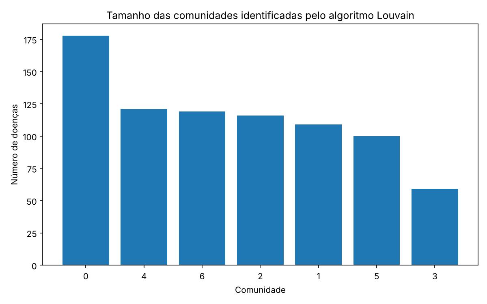

# Rede de doenças a partir de sintomas partilhados

Projeto da unidade curricular de Grafos e Redes Complexas (Licenciatura em Matemática Aplicada e Tecnologias Digitais, Iscte, 2025/26).

Construímos uma rede em que cada nó é uma doença e duas doenças estão ligadas quando partilham pelo menos um sintoma. O peso da ligação é o número de sintomas em comum. Depois analisámos a rede ao nível global, das comunidades e das doenças individuais.

**Pergunta de investigação:** de que forma é que as doenças se relacionam através dos sintomas que partilham, e que padrões estruturais emergem dessa rede?

## Como construímos a rede

1. Partimos de uma tabela com 246 945 registos e 377 sintomas codificados como presença (1) ou ausência (0).
2. Criámos uma rede **bipartida** doença–sintoma.
3. Projetámos essa rede em doenças, o que dá uma rede doença–doença com **802 nós e 67 671 arestas**.

## Resultados

**Nível global (macro)**

| Métrica | Valor |
|---|---|
| Nós / arestas | 802 / 67 671 |
| Densidade | 0,2107 |
| Componentes conectadas | 1 |
| Path length médio / diâmetro | 1,824 / 3 |

A rede é densa e totalmente conectada: não há doenças isoladas e quaisquer duas estão a poucos passos uma da outra.

**Comunidades (meso)**

- Clustering global de 0,535, clustering médio ponderado de 0,087 e assortatividade por grau de 0,219.
- O **Girvan–Newman** deu divisões muito desequilibradas (801 + 1, depois 800 + 1 + 1), por isso usámo-lo só como comparação.
- O **Louvain** encontrou **7 comunidades** de 178, 121, 119, 116, 109, 100 e 59 doenças.



**Doenças centrais (micro)**

Com degree centrality, strength, betweenness e closeness, destacam-se *Pain After An Operation*, *Hypokalemia*, *Drug Reaction*, *Acute Stress Reaction* e *Esophagitis*. A *Pain After An Operation* lidera em strength, betweenness e closeness, e a *Hypokalemia* em degree centrality.

Uma doença central aqui quer dizer que partilha sintomas com muitas outras. Não quer dizer que seja mais grave ou mais frequente.

## Limitações

- Os sintomas são só presença ou ausência, sem intensidade nem frequência.
- Basta um sintoma partilhado para criar uma ligação, e sintomas muito gerais (dor, febre, náuseas) tornam as ligações pouco específicas.
- Partilhar sintomas não implica relação causal entre doenças.
- Segundo a descrição do autor no Mendeley Data, o dataset foi **gerado artificialmente**. Os resultados descrevem a estrutura desses dados e não devem ser lidos como informação clínica.

## Como correr

O dataset tem cerca de 190 MB e **não está incluído** neste repositório. Descarrega-o de [Mendeley Data](https://data.mendeley.com/datasets/2cxccsxydc/1) (*Disease and symptoms dataset 2023*, DOI 10.17632/2cxccsxydc.1).

```bash
pip install pandas numpy networkx matplotlib
python analise_rede.py "Disease and symptoms dataset.csv"
```

Demora alguns minutos. A opção `--girvan-newman` corre também o Girvan–Newman, que é muito mais lento. A pasta `resultados/` já tem as tabelas e figuras de uma execução completa, e correr o script em versões diferentes do NetworkX pode dar pequenas diferenças nas comunidades do Louvain. Os exemplos de doenças de cada comunidade são as primeiras oito da lista e também podem variar.

## Relatório

O relatório completo está em `Relatorio_Redes_Complexas.pdf`.

## Autoras

Beatriz Correia, Catarina Pereira, Inês Ferreira e Maria Madalena Brás.
